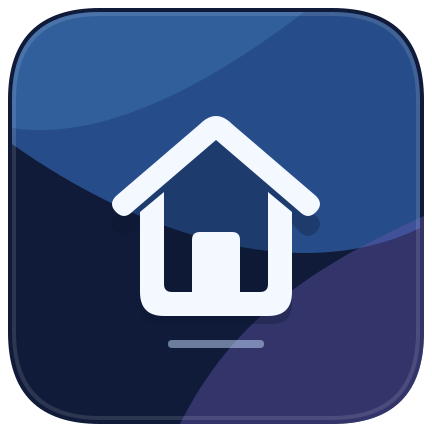
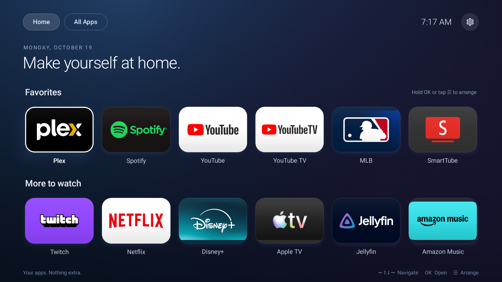

# HomeScreen



**An Apple TV-inspired home screen that cuts through Fire TV's ads and clutter.**

Replace the busy home screen with a calm gradient, large app artwork, and a simple
remote-friendly favorites grid. Your apps take center stage, without sponsored rows,
autoplay previews, or promoted content in the launcher.



## What you get

- A clean six-column app grid, Home and All Apps views, clock, and Settings shortcut.
- Favorites you can reorder and save. Highlight an app and press **Menu** or hold **OK**.
- Stable focus borders with no pulsing or zoom animation.
- Home button redirection and launch on boot through the companion **Home on Fire**.
- Built-in update checks: signed release APKs, SHA-256 verification, and Android's install flow.

Tested on **Fire OS 8.1.8.5**. This removes bloat from the home-screen experience;
it does not uninstall Amazon system packages, modify firmware, or remove ads inside
other apps. Compatibility with every Fire OS release is not guaranteed. Android-based
Fire OS is required; Vega OS is not supported by this Android APK.

## Install

1. Download the launcher APK from [Releases](https://github.com/arashvakil/HomeScreen/releases/latest).
2. Install Android platform-tools (`adb`) on your computer. On the TV, enable ADB
   debugging in Developer options, connect both devices to the same network, and
   accept the TV's debugging authorization prompt.
3. Download this repository, then run:

   ```sh
   ./scripts/setup.sh <fire-tv-ip>:5555 /path/to/homescreen-3.apk
   ```

The script installs HomeScreen plus the official, checksum-pinned
[Home on Fire v1.5.2](https://github.com/toolicious/home-on-fire/releases/tag/v1.5.2),
grants its setup permission, and opens its configuration screen. It downloads that
separate app directly from its upstream release; its code is not embedded in HomeScreen.
Home on Fire is independently maintained and licensed GPL-3.0-or-later.

On the TV, enable **Home on Fire's accessibility service**, select **Home** as its target,
and enable **Replace Home** and **Launch on boot**. Disable other launcher accessibility
redirectors to avoid conflicts. These final choices require the TV interface; the helper
does not expose an automated configuration API.

Press Home from another app to return here. **Hold Home** to escape to Amazon home;
hold Menu to open Home on Fire's settings. Amazon's launcher remains installed and
may briefly appear during redirection. To undo the redirect, disable Home on Fire's
accessibility service or uninstall the companion.

You can also install just the launcher with `adb -s <fire-tv-ip>:5555 install -r <apk>`
and open Home from your apps. Home-button and boot integration require the companion.

## Updates

Release builds check for updates roughly every six hours when connected, starting
shortly after launch. Fire OS power management can delay checks. The updater downloads
the APK, verifies its checksum, package, newer version, and signing certificate, then
shows an **Update** button on the home screen. Select it to open Android's package installer. **Allow Home under Developer options → Install unknown
apps** when prompted. Fire OS requires your choice to install and may show confirmation on the TV; updates are not
promised to install silently.

Updates come from this repository's latest GitHub release (`update.json` + APK).
Debug builds do not check. There is no analytics or advertising SDK; update checks
contact GitHub and its download infrastructure. App ordering stays locally on the TV.

An existing 0.2.0 studio installation needs one manual update to 0.3.0 to enable this
channel. Install over it with `adb -s <fire-tv-ip>:5555 install -r <apk>`; do not uninstall if you want to retain
favorites. Only releases signed by the same key can update an existing install.

## Build and publish

Use **JDK 17** and **Android SDK 34**:

```sh
./gradlew :app:testDebugUnitTest :app:assembleDebug :app:lintDebug
```

The public application ID is `nyc.arash.homescreen.studio`. Create a local, ignored
`personal-keystore.properties` with your own keystore:

```properties
storeFile=/absolute/path/to/your-release.jks
storePassword=YOUR_STORE_PASSWORD
keyAlias=YOUR_KEY_ALIAS
keyPassword=YOUR_KEY_PASSWORD
```

Back up the key privately: future updates must use it. Do not commit keys or passwords.
To build and prepare release assets without publishing:

```sh
./gradlew :app:assembleRelease
python3 scripts/prepare-release.py --notes 'Describe this release'
```

After review, passing PR checks, and merge, tag the merged commit `v<versionName>` and
push the tag. Then run `./scripts/deploy-update.sh` to publish the prepared APK and
manifest using authenticated GitHub CLI. Bump `versionCode` for every release. The
script verifies the remote tag exists; maintainers must verify it names the reviewed
commit. CI checks are credential-free and do not publish or sign releases.

Forks must change the update channel at build time:

```sh
./gradlew :app:assembleRelease -PupdateManifestUrl=https://your-host.example/update.json
```

Use `server/` as an optional static-hosting template, with HTTPS at your reverse proxy.
Its example manifest is not a production update. For historical package builds only,
`-PpersonalLauncher=false` retains `nyc.arash.homescreen` and uses `keystore.properties`;
serve a separate matching update channel. Do not mix package IDs or signing keys.

## Credits

Home-button integration is provided by [Home on Fire](https://github.com/toolicious/home-on-fire). HomeScreen is an
independent project and is not affiliated with Amazon or Apple.
