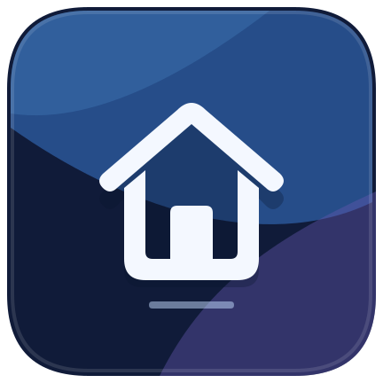
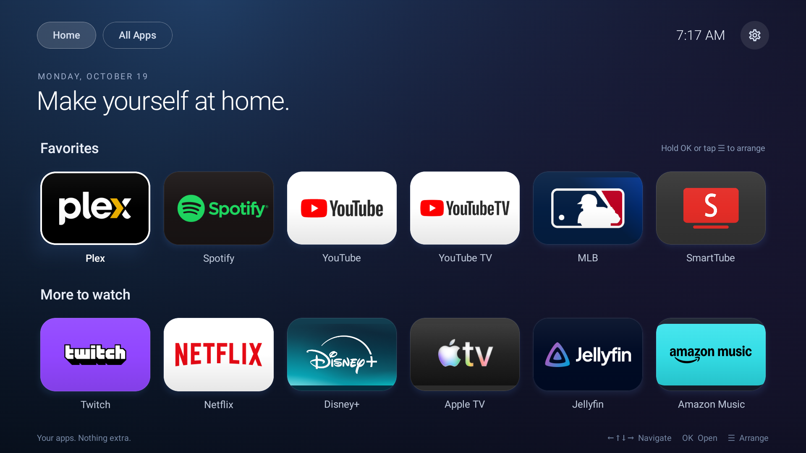

# HomeScreen



**An Apple TV-inspired home screen that cuts through Fire TV's ads and clutter.**

Replace the busy home screen with a calm gradient, large app artwork, and a simple
remote-friendly favorites grid. Your apps take center stage, without sponsored rows,
autoplay previews, or promoted content in the launcher.



## What you get

- A clean six-column app grid, Home and All Apps views, clock, and Settings shortcut.
- Favorites you can reorder and save. Highlight an app and press **Menu** or hold **OK**.
- Stable focus borders with no pulsing or zoom animation.
- Current weather for a city you choose, with saved Fahrenheit or Celsius units.
- A soft beep when D-pad navigation moves focus, using the TV’s system sound volume.
- Home button redirection and launch on boot through the companion **Home on Fire**.
- Built-in update checks: signed release APKs, SHA-256 verification, and Android's install flow.

Tested on **Fire OS 8.1.8.5**. This removes bloat from the home-screen experience;
it does not uninstall Amazon system packages, modify firmware, or remove ads inside
other apps. Compatibility with every Fire OS release is not guaranteed. Android-based
Fire OS is required; Vega OS is not supported by this Android APK.

## Install

1. Download the launcher APK from [Releases](https://github.com/arashvakil/HomeScreen/releases/latest).
2. Install Android platform-tools (`adb`) on your computer. On the TV, enable ADB
   debugging in Developer options, connect both devices to the same network, and
   accept the TV's debugging authorization prompt.
3. Download this repository, then run:

   ```sh
   ./scripts/setup.sh <fire-tv-ip>:5555 /path/to/homescreen-4.apk
   ```

The script installs HomeScreen plus the official, checksum-pinned
[Home on Fire v1.5.2](https://github.com/toolicious/home-on-fire/releases/tag/v1.5.2),
grants its setup permission, and opens its configuration screen. It downloads that
separate app directly from its upstream release; its code is not embedded in HomeScreen.
Home on Fire is independently maintained and licensed GPL-3.0-or-later.

On the TV, enable **Home on Fire's accessibility service**, select **Home** as its target,
and enable **Replace Home** and **Launch on boot**. Disable other launcher accessibility
redirectors to avoid conflicts. These final choices require the TV interface; the helper
does not expose an automated configuration API.

Press Home from another app to return here. **Hold Home** to escape to Amazon home;
hold Menu to open Home on Fire's settings. Amazon's launcher remains installed and
may briefly appear during redirection. To undo the redirect, disable Home on Fire's
accessibility service or uninstall the companion.

You can also install just the launcher with `adb -s <fire-tv-ip>:5555 install -r <apk>`
and open Home from your apps. Home-button and boot integration require the companion.

## Sync favorites between TVs

Open **Home Settings → Favorites sync** on the TV whose layout you want to share,
then choose **Share this TV’s favorites**. On another TV, choose **Join an existing
setup** and enter the eight-character code. Joining adopts the shared favorites.
Codes expire after 15 minutes and work once. No account or registration is required.

Favorites and their order sync automatically while Home is open, when returning to
Home, and periodically in the background. Offline edits are saved on the TV and
merged when it reconnects. Apps missing from one TV retain their shared positions
and appear when installed. Weather location and units stay local to each TV.

The linked screen offers **Link another TV**, **Sync now**, and **Unlink this TV**.
Unlinking keeps the current local favorites. Device access keys stay in private app
storage, which is excluded from Android backup. Clearing app data removes the link.

The default sync endpoint is `https://homescreen.arash.nyc/sync/v1`. Only favorites,
revisions, and device names are stored by the service. See [the sync service](server/sync/README.md)
for deployment, persistence, and recovery details.

## Weather and settings

Select **Set up weather** on a fresh installation, or open the gear for **Home Settings**. Choose **Choose a city**, enter
a city or postal code with the app’s remote-friendly keyboard, select **Search**,
then pick the matching city and region. **Use New York** provides a one-click shortcut. **Delete**, **Clear**, and **Back to Settings**
are explicit controls. **Back** returns directly to Settings. This screen never opens
the Fire TV system keyboard. A connected hardware keyboard can also type/search.
Select **Fahrenheit** or **Celsius**, then **Done**. The same screen
keeps a **Fire TV Settings** shortcut. Back from city search returns to Home Settings.

The home header summarizes the next possible or forecast precipitation. Open
**Weather** for the next 24 hours and a seven-day outlook, including precipitation
chance, total liquid-equivalent precipitation, and snowfall. Move focus across hour
cards and down daily cards with the remote to scroll. Forecast times follow the
selected city’s timezone. Hourly amounts and chances cover the hour ending at the
shown time; the next-event summary uses the start of that interval. Fahrenheit uses inches for precipitation; Celsius uses
millimeters for total precipitation and centimeters for snow.

“Possible” means at least a 40% hourly chance; “forecast” means predicted hourly
precipitation of at least 0.1 mm or snow of at least 0.1 cm. The next-event summary
includes rain, snow, freezing precipitation, and thunderstorms. A dry summary only
covers the available forecast window with complete precipitation data. These are
forecast estimates and can change.

No city is assumed on first launch. Weather uses the free non-commercial
[Open-Meteo API](https://open-meteo.com/en/docs); city search uses its
[GeoNames-backed geocoding API](https://open-meteo.com/en/docs/geocoding-api).
The chosen city/search term and city coordinates are sent to those services; the
launcher does not request GPS, infer an IP location, or add an account or API key.
Weather data is attributed to Open-Meteo under CC BY 4.0. Commercial distributions
must arrange an appropriate provider plan before using the free endpoint.

Current conditions refresh about every 15 minutes while the launcher is visible.
Returning home reuses a fresh cached reading instead of making another request.
A failed update keeps a recent reading with an explicit notice and its observation
time; readings over two hours old are hidden. Without a cached reading, connection
failures show weather unavailable. Search errors can be retried without losing the
saved city. Temperature units change immediately without another network request.

## Updates

Release builds check for updates roughly every six hours when connected, starting
shortly after launch. Fire OS power management can delay checks. The updater downloads
the APK, verifies its checksum, package, newer version, and signing certificate, then
shows an **Update** button on the home screen. Select it to open Android's package installer. **Allow Home under Developer options → Install unknown
apps** when prompted. Fire OS requires your choice to install and may show confirmation on the TV; updates are not
promised to install silently.

Updates come from this repository's latest GitHub release (`update.json` + APK).
Debug builds do not check. There is no analytics or advertising SDK; update checks
contact GitHub and its download infrastructure. App ordering and weather preferences stay locally on the TV.

An existing 0.2.0 studio installation needs one manual update to 0.3.0 to enable this
channel. Install over it with `adb -s <fire-tv-ip>:5555 install -r <apk>`; do not uninstall if you want to retain
favorites. Only releases signed by the same key can update an existing install.

For the Fire TV keyboard regression, open Home Preview → Settings → Choose a city,
then run `python3 scripts/check-city-keyboard.py --serial <device-serial>`. The check
verifies city entry opens without a system keyboard, Back returns to Settings, and
city entry can be reopened and exited without changing saved preferences.

## Build and publish

Use **JDK 17** and **Android SDK 34**:

```sh
./gradlew :app:testDebugUnitTest :app:assembleDebug :app:lintDebug
```

PR checks also save a three-day `homescreen-debug` APK artifact for device testing.
It installs separately from the release launcher and does not check for updates.

The public application ID is `nyc.arash.homescreen.studio`. Create a local, ignored
`personal-keystore.properties` with your own keystore:

```properties
storeFile=/absolute/path/to/your-release.jks
storePassword=YOUR_STORE_PASSWORD
keyAlias=YOUR_KEY_ALIAS
keyPassword=YOUR_KEY_PASSWORD
```

Back up the key privately: future updates must use it. Do not commit keys or passwords.
To build and prepare release assets without publishing:

```sh
./gradlew :app:assembleRelease
python3 scripts/prepare-release.py --notes 'Describe this release'
```

After review, passing PR checks, and merge, tag the merged commit `v<versionName>` and
push the tag. Then run `./scripts/deploy-update.sh` to publish the prepared APK and
manifest using authenticated GitHub CLI. Bump `versionCode` for every release. The
script verifies the remote tag exists; maintainers must verify it names the reviewed
commit. CI checks are credential-free and do not publish or sign releases.

Forks must change the update channel at build time:

```sh
./gradlew :app:assembleRelease -PupdateManifestUrl=https://your-host.example/update.json
```

Use `server/` as an optional static-hosting template, with HTTPS at your reverse proxy.
Its example manifest is not a production update. For historical package builds only,
`-PpersonalLauncher=false` retains `nyc.arash.homescreen` and uses `keystore.properties`;
serve a separate matching update channel. Do not mix package IDs or signing keys.

## License

HomeScreen is open source under the [MIT License](LICENSE), copyright 2026 Arash Vakil.
Third-party dependencies retain their respective licenses.

[Home on Fire](https://github.com/toolicious/home-on-fire) is a separate companion
application licensed GPL-3.0-or-later. It is downloaded from its upstream release
and is not included in HomeScreen's source or APK; HomeScreen's MIT license does
not relicense that companion.

## Credits

Home-button integration is provided by [Home on Fire](https://github.com/toolicious/home-on-fire). HomeScreen is an
independent project and is not affiliated with Amazon or Apple.
